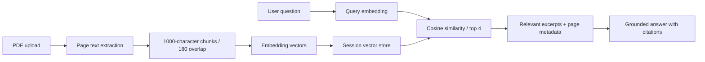

# Folio — AI Knowledge Base Chatbot

A thoughtfully designed PDF chat workspace built with **Next.js App Router, TypeScript, and Tailwind CSS**. Upload documents, ask questions, inspect page-level citations, and return to saved conversations.

## Run locally

Requires Node.js 22 LTS or newer.

```bash
npm install
cp .env.example .env.local
npm run dev
```

Open http://localhost:3000. On Windows PowerShell, use `Copy-Item .env.example .env.local`.

Try uploading `public/sample-research.pdf`, then ask **“What was the revenue growth?”** or **“What are the onboarding recommendations?”**. The included two-page document contains fictional research data for demonstration.

Without an API key, the app runs in **local demo mode**: hashed keyword vectors and cosine similarity retrieve real PDF excerpts. This mode does not generate AI answers or provide semantic embeddings. To enable full RAG, add `OPENAI_API_KEY` to `.env.local`, restart, and upload your documents. Changing embedding mode requires removing and re-uploading previously indexed PDFs.

## Features

- PDF upload with drag and drop, type validation, 10 MB file limit, page-aware text extraction, and chunk indexing.
- Semantic vector search with `text-embedding-3-small` when an API key is configured.
- Grounded AI responses using retrieved passages and recent conversation context.
- Clickable citations with document name, page, original excerpt, and retrieval similarity.
- Persistent conversation history, history search, new chats, and deletion.
- Knowledge library with page counts, chunk counts, document deletion, and document-scoped queries.
- Responsive interface, keyboard submission, accessible controls, processing indicators, and error handling.
- Server-only API credentials and isolated anonymous workspaces.

## How RAG works



Vectors, extracted text, and chat history persist in `.data/`, separated by an HTTP-only session cookie. Atomic file writes and per-session locks prevent conflicting updates in a single server process. No original PDF binaries are retained. The browser's session cookie identifies the workspace; clearing cookies loses access to that workspace.

## Project structure

```text
app/page.tsx                 Interactive chat and library interface
app/api/upload/route.ts      PDF parsing, chunking, and embedding
app/api/chat/route.ts        Retrieval, answer generation, history
app/api/workspace/route.ts   Workspace loading and deletion
lib/retrieval.ts             Chunking, local vectors, cosine similarity
lib/ai.ts                    Server-side embedding and model calls
lib/store.ts                 Session isolation and persistent storage
tests/retrieval.test.ts      Retrieval correctness checks
```

## Verification

```bash
npm run typecheck
npm test
npm run build
```

With the server running in demo mode, run `node scripts/smoke.mjs` to verify PDF upload, page citations, chat persistence, session isolation, and deletion against the actual API. This check uploads and then removes its sample document and conversation.

## Deployment and scope

This is a portfolio MVP for a **single Node.js server with persistent disk**. Start production with `npm run build && npm start`. An ephemeral serverless filesystem is unsuitable for this store. For a public multi-user deployment, replace the local store with Postgres + pgvector or a managed vector database, add authentication, rate limits, request-body limits at the proxy, quotas, and retention controls. The current anonymous session is workspace isolation, not an authenticated account. The profile avatar is decorative.

PDFs must contain selectable text; scanned documents require OCR. Maximum 20 documents per workspace and 250 chunks per PDF. Live mode sends extracted text and questions to the configured AI provider. Citation numbers in generated text are model-generated; source cards always show the actual retrieved passages, so verify claims against those excerpts. Similarity is not confidence. Page previews show extracted text, not the original PDF renderer.

## Portfolio talking points

- Built an end-to-end RAG pipeline rather than a static chat mockup.
- Preserved page provenance through parsing, chunking, retrieval, and source display.
- Kept secrets server-side and made the demo usable without paid API credentials.
- Designed explicit empty, loading, error, source inspection, and mobile states.
- Chose a readable, dependency-light local vector store and documented its deployment limits.

References: [Next.js route handlers](https://nextjs.org/docs/app/api-reference/file-conventions/route), [OpenAI embeddings](https://developers.openai.com/api/reference/resources/embeddings/methods/create), [pdf-parse](https://www.npmjs.com/package/pdf-parse).
